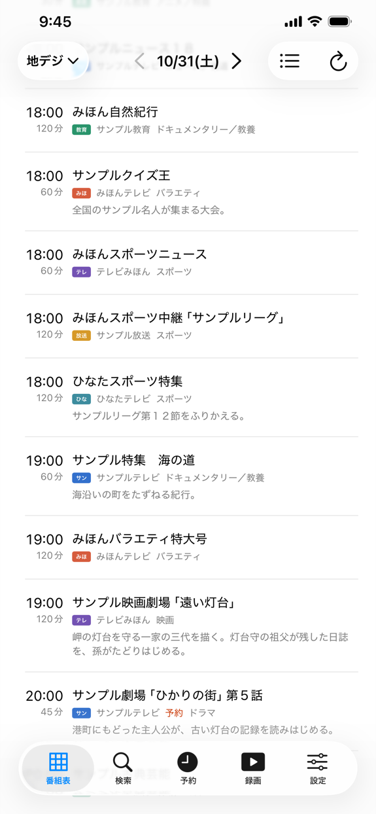
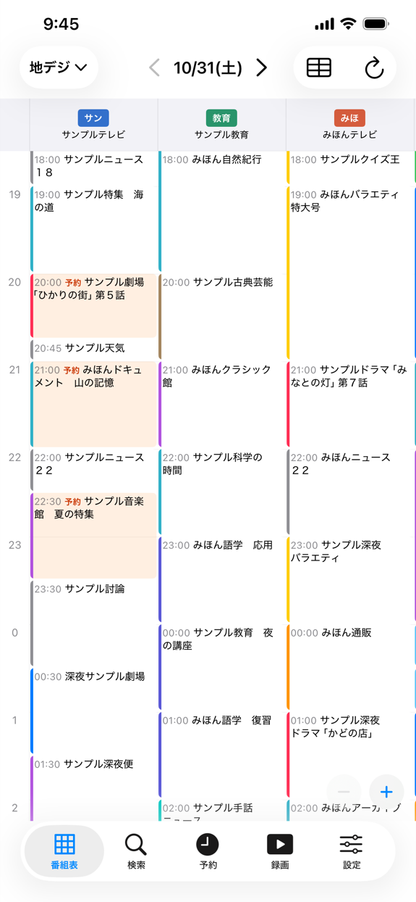
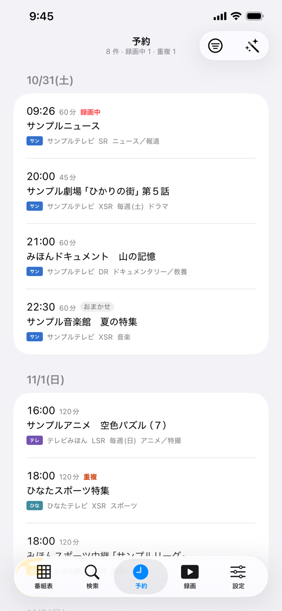

# RecBridge（bdzbridge）

Sony BDZ（Blu-ray レコーダー）と、USB ハードディスクに録画できるソニーのテレビのための、番組表・録画予約ブリッジです。2027 年 3 月に終了する Video & TV SideView の代わりに、スマホから番組表を見て予約し、録画を整理するために作りました。レコーダー自身が受信した 8 日分の番組表、レコーダーの UPnP 予約サービス、テレビの制御 API を使います。レコーダーのない家でも、テレビに RecBridge ヘルパーを入れれば、テレビの番組表から予約できます（0.5 から）。インターネット上のサービスには依存しません。

アプリの名前は RecBridge です。このリポジトリと、サーバー（`bdzbridge` パッケージ）と PWA は bdzbridge という名前のままです。

Sony 非公式のソフトウェアです。レコーダーやテレビが LAN 内に公開している機能を相互運用のために利用しているだけで、映像・音声の保護（DTCP-IP）には触れていません。ヘルパーがテレビの中で読むのは、番組表の局・番組・局ロゴだけです。予約や削除はレコーダーやテレビの本体に届く操作で、とくに録画の削除は取り消せません。[ご利用上の注意](docs/disclaimer.md) と [プライバシーポリシー](docs/privacy.md) をお読みください。

## 入手

RecBridge は iPhone（iOS 17 以降）向けに、[App Store](https://apps.apple.com/jp/app/recbridge/id6812831646) で配布しています。App Store にあるのは 0.4 です。「0.5 から」と書いたものは、次の版から使えます。

### 自分でビルドする

手順とコマンドは `app/README.md` にあります。Apple は無料の Apple アカウントでも
[実機テストができる](https://developer.apple.com/support/compare-memberships/)としています（デバイス 3 台、
1 台につきアプリ 3 つ、プロファイルは 7 日で失効）。このアプリはエンタイトルメントを必要としないので無料の
アカウントでも署名できる見込みですが、**開発に使っているのは有料メンバーシップで、無料での確認はしていません。**

```
brew install xcodegen
cd app && xcodegen generate && open BDBridge.xcodeproj
```

## ほかにあるもの

- **Android アプリ**（`android/`）。開発中で、配布していません。
- **RecBridge ヘルパー**（`helper/`）。テレビ（Android TV の BRAVIA）に入れる小さなアプリで、テレビの番組表を RecBridge に配ります（0.5 から）。配布は準備中です。
- **サーバー + PWA**（`server/`、`web/`）。ブラウザから使えて、キーワード自動予約のように常時動くものを担います。相手はレコーダーだけです。レコーダーにつないだ USB ハードディスクは、こちらでも録画先に選べて、録画も一覧に並びます。アプリとサーバー + PWA は、どちらか片方だけでも成り立ちます。

## 画面

| iOS アプリ（番組表・リスト） | iOS アプリ（番組表・表） | iOS アプリ（予約） |
|---|---|---|
|  |  |  |

画像はアプリのサンプルデータで撮ったもので、局も番組も架空です。表モードは横にチャンネル、縦に時間で、ピンチで時間軸を伸縮できます。番組表のデータと局ロゴはレコーダー（ヘルパーを使う家ではテレビ）が受信したもので、このリポジトリには含まれていません。ロゴを持たない局は名前だけで表示します（レコーダー自身の画面もそうなります）。

## 使い方

### iOS アプリ

アプリはレコーダーやテレビと直接話し、番組表を端末内に持つので外出先でも読めます。外出先で入れた予約は「送信待ち」として預かり、次にレコーダーやテレビにつながったときに送ります。USB ハードディスクに録画できるソニーのテレビにも、直接予約を送れます。テレビの予約と、レコーダーやテレビにつないだ USB ハードディスクの録画も一覧に並び、レコーダーの USB ハードディスクは録画先にも選べます。

初回は起動時のセットアップ画面で「レコーダーとテレビを探す」を押して選びます（このときだけレコーダーの電源が入っている必要があります）。テレビは、テレビの画面に出る 4 桁の番号で登録します。レコーダーが無くても「サンプルデータで試す」で動きを確かめられます。

つながると番組表を自動で取得し、以後は夜中にバックグラウンドで取り直します。ただし、夜中の取り直しを走らせるかどうかは iOS が決めます。アプリを強制終了しているとき、App のバックグラウンド更新がオフのとき、低電力モードのときは走りません。走らなかった夜のぶんは、次につないだときに取り直します。レコーダーが LAN から消えていれば Wake-on-LAN で起こしてからつなぎます。

予約タブの右上からレコーダー本体の「おまかせ・まる録」（キーワード自動録画）を登録・削除できます。レコーダー自身が
番組を探して録るので、アプリもサーバーも動いていなくて構いません。対象チャンネルの絞り込みだけは本体でしか設定できません。

### テレビの番組表（ヘルパー、0.5 から）

ヘルパーの配布は準備中です。入れ方とビルドの方法は `helper/README.md` にあります。テレビで「登録の番号を出す」を押して出る 6 桁の番号を、アプリの 設定 → テレビ → 「ヘルパーに登録」に入れます。レコーダーもある家では、設定の「番組表の取得元」でどちらを使うか選べます。テレビの番組表は夜中ではなく、アプリを開いたときに取り直します。テレビを選んでいる間は、レコーダーにつないだときも夜中も、レコーダーの番組表は取りません（夜中に送信待ちの予約を送ることと、残容量を確かめることは続けます）。

### サーバーと PWA

Python 3.12 以降と uv、Node.js が要ります。

```
cd web
npm install && npm run build   # web/dist を作る（サーバーが / で配信する）
cd ../server
uv sync --group dev
cp .env.example .env           # BDZBRIDGE_API_TOKEN を設定
uv run python -m bdzbridge     # http://127.0.0.1:8000/ （LAN に出すなら BDZBRIDGE_BIND_HOST=0.0.0.0）
```

予約画面の「レコーダーのおまかせ・まる録」からも同じ条件を本体に登録できます。サーバー側の「自動予約」（番組表の
更新のたびにこちらで予約を入れるもの）とは別で、本体に登録したものはサーバーが止まっていても働きます。

初回はブラウザでトークンを入力し、LAN 内のレコーダーを探索して選びます。選択は保存され、DHCP で IP が変わっても追従します。PWA を更新したときも、`web/` で `npm install && npm run build` してサーバーを再起動します。外出先から使うなら Tailscale などの VPN 越しにしてください。

## 動作確認機種

- レコーダー: BDZ-FBT4100（2021 年モデル）。他の機種は `description.xml` の `EPG_CAP` が `01` であれば番組表も取れる見込みですが未確認です。
- テレビ: BRAVIA XRJ-65X95K（Android 12）。ヘルパーで確かめたことと、まだのことは `helper/README.md` にあります。他の機種は未確認です。

## 再生について

録画番組をスマホで観る機能はありません。録画番組の配信は DTCP-IP の保護下にあり、本ソフトは扱いません。レコーダー自身が申告している配信形式もほぼすべて DTCP-IP 付きです（`docs/upnp/connectionmanager-answers.txt`）。

録画タブの「テレビで再生」はレコーダー自身に再生させる機能で、レコーダーにつながったテレビに映ります（レコーダーの電源が入ります）。一時停止・再開・停止もできます。テレビの USB ハードディスクの録画には、この機能はありません。

録画一覧にサムネイルは出しません。レコーダーが返す画像は全タイトル共通のダミー画像でした。

## 注意

- レコーダーの API は無認証です。このサーバーを LAN の外に直接公開しないでください。
- 予約の作成・変更・削除は実機に反映されます。

## 構成

```
app/      iOS アプリ（Swift / SwiftUI）  ─┐ レコーダーの :64220 と :60151、テレビの :80、
android/  Android アプリ（開発中）       ─┘ テレビのヘルパーの :8780 を直接使う
helper/   テレビに入れるヘルパー         ── テレビの番組表を :8780 で配る
server/   FastAPI サーバー ── web/  PWA  ── レコーダーの :64220 と :60151 を直接使う
docs/     レコーダーの仕様（観察に基づく）と移植ガイド
```

- `app/` — iOS アプリ。`app/RecorderKit` はレコーダーやテレビ、ヘルパーと話す層です（プロトコル、番組表ファイルのデコーダ、HTTP クライアント、端末内キャッシュ）。`app/RecBridgeModel` は画面が共有するモデルです。どちらも UI を持たず単体でテストでき、Android アプリもそのまま使います。`app/BDBridge` は画面と、キーチェーンや通知のように iPhone にしかないものです。Xcode プロジェクトは `app/project.yml` から XcodeGen で生成しますが、コミットしています（Xcode Cloud がリポジトリ内のプロジェクトを探すため）。詳しくは `app/README.md`。
- `android/` — Android アプリ。Kotlin と Jetpack Compose の画面から、Android 向けにビルドした上の 2 つを swift-java で呼びます。ビルドの手順は `android/README.md`。
- `helper/` — RecBridge ヘルパー（Kotlin）。入れ方と API は `helper/README.md`。
- `server/` — FastAPI サーバー（`bdzbridge` パッケージ）。API と PWA の配信、番組表のキャッシュ、レコーダー探索、キーワード自動予約。
- `web/` — Vite + Svelte 5 の PWA。`/api/v1` を同一オリジンで使います。
- `docs/` — 予約 API（`xsrs-api.md`）と番組表ファイル形式（`epg-format.md`）の仕様、レコーダーが実際に何を答えるかの実測（`upnp/service-sweep.md`）、HTTP API リファレンス（`api.md`）、移植ガイド（`porting.md`）と言語非依存の検証ベクタ（`port/`）、Android 版の検討の記録（`android-port-study.md`、`multiplatform.md`）。
- `ci_scripts/`、`.github/`、`.githooks/` — Xcode Cloud のスクリプト、RecorderKit とモデルを Android 向けにビルドしてテストする GitHub Actions、コミット前のフック。

アプリ（`app/RecorderKit`）とサーバーの実装は同じ観察に基づいていて、`docs/port/` のベクタで突き合わせています。移植を考える人はそこから読むのが早いはずです。

## ライセンス

MIT License。`LICENSE` を参照してください。
